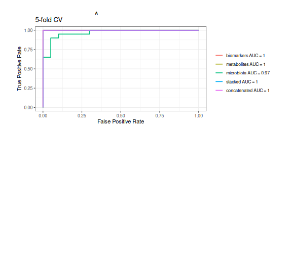
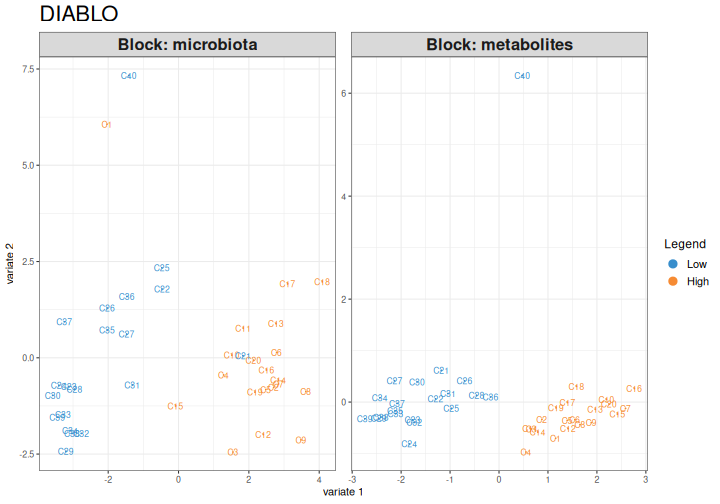
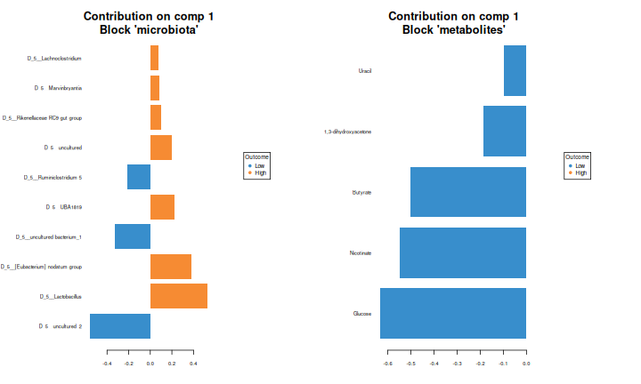
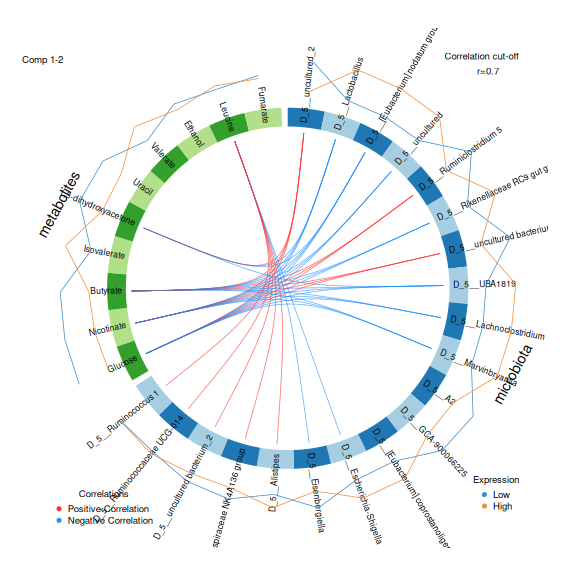
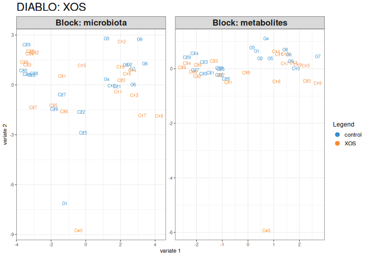
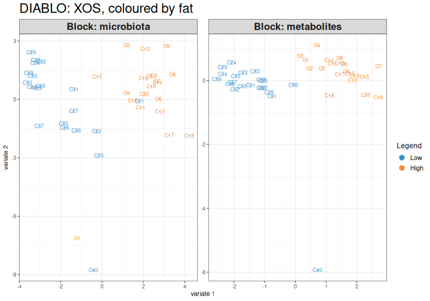

:::::::::::::::::::::::::::::::::::::: questions

- Can we predict an outcome from several data types together?
- Which data types and which features predict the outcome?
- What are early, intermediate and late fusion?

::::::::::::::::::::::::::::::::::::::::::::::::

::::::::::::::::::::::::::::::::::::: objectives

- Explain early, intermediate and late fusion (stacking) of several data types.
- Train a multi-omics prediction model with IntegratedLearner and evaluate it with cross-validation.
- Interpret the weights that IntegratedLearner gives to each data type.
- Explain the idea of sparse partial least squares, and find the features of several data types that together tell the groups apart with DIABLO.
- Describe what IntegratedLearner and DIABLO show about the data.

::::::::::::::::::::::::::::::::::::::::::::::::


## Where are we?


In the [previous episode](04-unsupervised.Rmd), the unsupervised methods
found the main pattern that the data types share: the fat in the diet. They
did not find the effect of XOS, because it is smaller.

**Supervised** methods are given an outcome, such as the diet group, and look
for the features that predict it. Machine learning on a
single microbiome table can predict, for example, a disease. Now we predict
from **several data types**.

| Method | What it gives |
|---|---|
| IntegratedLearner | A prediction from all data types, how well it works, and how much each data type contributes |
| DIABLO | The features of each data type that together tell the groups apart |

## Load packages


``` r
library(mia)
library(MultiAssayExperiment)
library(IntegratedLearner)
library(mixOmics)
```

We continue with the `mae` object that we prepared in
[episode 2](02-multiassayexperiment.Rmd).

## Three ways to combine data types

How do we feed several tables to one prediction model? There are three
common strategies, called **fusion**:


*Figure: [IntegratedLearner](https://github.com/himelmallick/IntegratedLearner)
(MIT licence).*

- **Early fusion**: join all tables side by side into one big table, and
  train one model on it. This is simple, but the largest table (here the
  microbiota) can dominate the model.
- **Intermediate fusion**: train a model on each table, join what the models
  learned, and train one more model on top.
- **Late fusion**: train a separate model on each table, and combine their
  *predictions*, for example as a weighted average. The weights tell how
  much each data type contributes. Combining predictions with a second
  model is called **stacking**.

## IntegratedLearner

**IntegratedLearner** (Mallick et al. 2024) fits both early fusion (the
*concatenated* model) and late fusion (the *stacked* model), and compares
them with the models of the single data types. It can use many machine
learning methods as *base learners*, the models of the single data types; we
use **random forest**.

How does stacking work? Each base learner predicts every rat with
cross-validation, so each rat gets one predicted probability per data type
from models that did not see it. A *meta-learner* then learns how to combine
these probabilities. By default, it finds non-negative weights that sum to 1
and give the best AUC. A data type that predicts well gets a large weight,
and a data type that adds nothing gets a weight near 0.

### Prepare the data

IntegratedLearner reads the outcome and the sample IDs from the sample
information of each experiment, not from the shared `colData()` of the MAE.
`getWithColData()` adds the sample information to an experiment, as in
episode 2. We do this for each of the three experiments:


``` r
mae[["microbiota"]] <- getWithColData(mae, "microbiota")
mae[["metabolites"]] <- getWithColData(mae, "metabolites")
mae[["biomarkers"]] <- getWithColData(mae, "biomarkers")
colnames(colData(mae[["metabolites"]]))
```

``` output
[1] "Sample" "Rat"    "Site"   "Diet"   "Fat"    "XOS"   
```

### Train the model

We predict whether a rat was fed the high-fat diet (`Fat`). The arguments
are:

- `experiment` and `assay.type`: the data types and the table to use from
  each. Random forest works directly on the counts of the microbiota.
- `outcome_col` and `subject_id_col`: the columns of the sample information
  with the outcome and the rat.
- `na.rm = TRUE`: drop the features with missing values (some biomarkers).
- `folds = 5`: evaluate the models with 5-fold cross-validation.
- `base_learner`: the machine learning method, here random forest.
- `family = binomial()`: the outcome has two classes.
- `seed`: fixes the random split into folds. The random forests are random
  too, so we also run `set.seed()` first.


``` r
set.seed(123)
fit <- IntegratedLearner(
    MAE_train = mae,
    experiment = c("microbiota", "metabolites", "biomarkers"),
    assay.type = c("counts", "log10", "signals"),
    outcome_col = "Fat",
    subject_id_col = "Sample",
    na.rm = TRUE,
    folds = 5,
    base_learner = "SL.randomForest",
    family = binomial(),
    seed = 123
)
```

``` output
Time for model fit : 0.027 minutes 
========================================
Model fit for individual layers: SL.randomForest 
Model fit for stacked layer: sl_nnls_auc 
Model fit for concatenated layer: SL.randomForest 
========================================
AUC metric for training data: 
Individual layers: 
 biomarkers metabolites  microbiota 
      1.000       1.000       0.968 
======================
Stacked model:1 
======================
Concatenated model:1 
======================
========================================
Weights for individual layers predictions in IntegratedLearner: 
 biomarkers metabolites  microbiota 
      0.579       0.016       0.405 
========================================
```

The summary shows the AUC of each model. The printout calls it "training
data", but the AUCs are calculated from the **cross-validated** predictions:
each rat is predicted by a model that did not see it during training, as
with a separate test set.

### How good are the predictions?

`fit$metrics.train` collects the AUC, accuracy and balanced accuracy of each
model:


``` r
fit$metrics.train
```

``` output
         model   auc accuracy balanced_accuracy
1   biomarkers 1.000      1.0               1.0
2  metabolites 1.000      1.0               1.0
3   microbiota 0.968      0.9               0.9
4      stacked 1.000      1.0               1.0
5 concatenated 1.000      1.0               1.0
```

`plot()` draws the ROC curve of each model. It returns the plot and a table
of the curves; we show only the plot:


``` r
plot(fit)$plot
```




**Result:** every model predicts the fat in the diet very well (cross-validated
AUC from 0.968 to 1). The fat has such a large effect that
any one data type is enough to predict it.

### How much does each data type contribute?

The late fusion (stacked) model combines the predictions of the three data
types with weights:


``` r
fit$weights
```

``` output
 biomarkers metabolites  microbiota 
 0.57877869  0.01623401  0.40498730 
```

**Result:** the stacked model relies most on the
biomarkers
(weight 0.58). But when all data types predict
equally well, as here, any of them will do, and the weights change a lot
with the random seed. Interpret the weights only when the data types differ
in how well they predict.

::::::::::::::::::::::::::::::::::::: challenge

## Challenge 1 (about 20 minutes): Can we predict XOS?

The unsupervised methods could not find the effect of XOS. Can a supervised
method predict it?

1. Train an IntegratedLearner model that predicts `XOS` instead of `Fat`,
   with the same settings otherwise.
2. Look at the AUC of each model. Which data type predicts XOS best? How
   well does it work compared with predicting the fat?
3. Look at the weights of the stacked model. Which data types does it use?
4. Does combining the data types improve the prediction over the best single
   data type?

:::::::::::::::::::::::: solution


``` r
set.seed(123)
fit_xos <- IntegratedLearner(
    MAE_train = mae,
    experiment = c("microbiota", "metabolites", "biomarkers"),
    assay.type = c("counts", "log10", "signals"),
    outcome_col = "XOS",
    subject_id_col = "Sample",
    na.rm = TRUE,
    folds = 5,
    base_learner = "SL.randomForest",
    family = binomial(),
    seed = 123
)
```

``` output
Time for model fit : 0.023 minutes 
========================================
Model fit for individual layers: SL.randomForest 
Model fit for stacked layer: sl_nnls_auc 
Model fit for concatenated layer: SL.randomForest 
========================================
AUC metric for training data: 
Individual layers: 
 biomarkers metabolites  microbiota 
      0.575       0.609       0.425 
======================
Stacked model:0.565 
======================
Concatenated model:0.531 
======================
========================================
Weights for individual layers predictions in IntegratedLearner: 
 biomarkers metabolites  microbiota 
      0.526       0.405       0.069 
========================================
```

``` r
fit_xos$metrics.train
```

``` output
         model   auc accuracy balanced_accuracy
1   biomarkers 0.575    0.575             0.575
2  metabolites 0.609    0.550             0.550
3   microbiota 0.425    0.425             0.425
4      stacked 0.565    0.575             0.575
5 concatenated 0.531    0.500             0.500
```

``` r
fit_xos$weights
```

``` output
 biomarkers metabolites  microbiota 
 0.52577398  0.40494153  0.06928449 
```


XOS is much harder to predict than the fat. The best single data type is
the metabolites (AUC 0.609). The stacked model
has an AUC of 0.565 and the concatenated model
0.531.

Neither combined model is better than the best single data type.
Combining the data types does not create a signal that is not in the data.
With only 40 rats and a small effect, the predictions are uncertain: with
another random seed, the numbers change. An AUC around 0.6 is only a little
better than guessing (0.5).

:::::::::::::::::::::::::::::::::
::::::::::::::::::::::::::::::::::::::::::::::::

::::::::::::::::::::::::::::::::::::: callout

## More in IntegratedLearner

- `base_learner = "sl_bart"` (the default) uses Bayesian additive
  regression trees, which also give the uncertainty of the predictions and of
  the feature importance. It needs Java and takes longer to run.
- `run_intermediate = TRUE` fits an intermediate fusion model (cooperative
  learning).
- `MAE_valid` takes an independent validation dataset.

See the [IntegratedLearner](https://github.com/himelmallick/IntegratedLearner)
documentation and the OMA chapter on
[machine learning](https://microbiome.github.io/OMA/docs/devel/pages/machine_learning.html).

:::::::::::::::::::::::::::::::::::::::::::::::

## DIABLO

IntegratedLearner tells us *how well* the data types predict the outcome.
**DIABLO** (Singh et al. 2019), from the mixOmics package, focuses on *which
features* do it. It looks for a few components (like PCA axes) that

- separate the groups, and
- are correlated between the data types,

and it selects a small number of features from each data type for each
component.

DIABLO is based on **sparse partial least squares (sPLS)**. A PCA finds the
direction in one table along which the samples vary most. PLS instead finds
one direction in each table, chosen so that the sample scores along the
directions are as **correlated** as possible, between the tables and with the
outcome. *Sparse* means that only a few features get a non-zero weight; the
others are set to 0. The selected features form a short signature.

### Prepare the data

mixOmics does not read a MAE. It takes a list of matrices with the
**samples as rows**, so we transpose the tables with `t()`. We use the rclr
values of the microbiota and the log10 values of the metabolites:


``` r
X <- list(
    microbiota = t(assay(mae[["microbiota"]], "rclr")),
    metabolites = t(assay(mae[["metabolites"]], "log10"))
)
Y <- mae$Fat
identical(rownames(X$microbiota), rownames(X$metabolites))
```

``` output
[1] TRUE
```

``` r
identical(rownames(X$microbiota), rownames(colData(mae)))
```

``` output
[1] TRUE
```

The rows of both matrices and the outcome must be in the same order; the two
checks confirm it. We leave out the biomarkers, which have missing values.
DIABLO standardizes each feature itself (`scale = TRUE`).

### Train the model

DIABLO needs the number of components (`ncomp`) and the number of features
to select from each data type for each component (`keepX`). Here we select
10 genera and 5 metabolites for each of 2 components:


``` r
diablo <- block.splsda(
    X, Y, ncomp = 2,
    keepX = list(microbiota = c(10, 10), metabolites = c(5, 5))
)
```

The `design` argument sets how strongly the components of the data types
should be correlated with each other, from 0 to 1. By default, it is 1:
DIABLO looks for components that are as correlated as possible between the
data types. A smaller value, such as 0.1, puts more weight on separating
the groups.

### Plot the samples

`plotIndiv()` draws the samples on the first two components, once for each
data type:


``` r
plotIndiv(diablo, legend = TRUE, title = "DIABLO")
```



**Result:** in both data types, the first component clearly separates the
high-fat and the low-fat rats.

### How good is it?

The separation in the plot is on the same data that the model was trained
on. As always in machine learning, we estimate the error with
cross-validation. `perf()` repeats a 5-fold cross-validation 10 times. The
folds are random, so we fix them with the `seed` argument:


``` r
perf_diablo <- perf(diablo, validation = "Mfold", folds = 5, nrepeat = 10,
                    seed = 123)
perf_diablo$WeightedVote.error.rate$centroids.dist
```

``` output
             comp1 comp2
Low         0.0700 0.065
High        0.0050 0.005
Overall.ER  0.0375 0.035
Overall.BER 0.0375 0.035
```


The table shows the error rate for each group and overall (`Overall.ER`),
with one and with two components.

**Result:** with one component, 4 % of the rats are
classified wrongly, and with two components 4 %.

### Which features tell the groups apart?

`plotLoadings()` shows the features selected for a component and their
weights. `contrib = "max"` colours each feature by the group in which it is
highest:


``` r
plotLoadings(diablo, comp = 1, contrib = "max", method = "median")
```



`circosPlot()` draws the correlations between the selected features of the
two data types. Lines connect features with a correlation above `cutoff`:


``` r
circosPlot(diablo, cutoff = 0.7, line = TRUE, size.labels = 1.2,
           size.variables = 0.7)
```



The selected features of component 1 are also listed by `selectVar()`:


``` r
selectVar(diablo, comp = 1)$metabolites$name
```

``` output
[1] "Glucose"              "Nicotinate"           "Butyrate"            
[4] "1,3-dihydroxyacetone" "Uracil"              
```

**Result:** the metabolites that tell the diets apart on component 1 are
Glucose, Nicotinate, Butyrate, 1,3-dihydroxyacetone, Uracil.
The circos plot shows that several of them are strongly correlated with the
selected genera, both positively and negatively.

::::::::::::::::::::::::::::::::::::: challenge

## Challenge 2: Compare the methods

1. Compare the metabolites selected by DIABLO with the metabolites that
   MiRKAT found in episode 3, and those with the largest weights on MOFA
   factor 1 in episode 4. Which metabolites appear in all of them?
2. What does each method tell you that the others do not?

:::::::::::::::::::::::: solution

1. All five metabolites that DIABLO selected are also significant in MiRKAT
   and among the ten largest weights of MOFA factor 1. Glucose, butyrate and
   nicotinate are at the top of all three lists. Metabolites that are found
   by methods that work in different ways are good candidates for follow-up.

2. MiRKAT tells which metabolites are related to the microbiota as a whole.
   MOFA tells which features drive the main shared pattern, without knowing
   the groups. DIABLO selects the features that *together* tell the groups
   apart and are correlated between the data types. IntegratedLearner tells
   how well the data types predict the outcome, and how much each of them
   contributes.

:::::::::::::::::::::::::::::::::
::::::::::::::::::::::::::::::::::::::::::::::::

::::::::::::::::::::::::::::::::::::: challenge

## Challenge 3 (about 15 minutes): DIABLO for XOS

1. Train a DIABLO model that predicts `XOS`, with the same settings.
2. Draw the samples with `plotIndiv()`. Are the groups separated?
3. Estimate the error with `perf()`. Compare it with the model for the fat.
4. Draw the samples again, but colour them by fat (`group = mae$Fat`). What
   does the first component separate?

:::::::::::::::::::::::: solution


``` r
diablo_xos <- block.splsda(
    X, mae$XOS, ncomp = 2,
    keepX = list(microbiota = c(10, 10), metabolites = c(5, 5))
)
plotIndiv(diablo_xos, legend = TRUE, title = "DIABLO: XOS")
```




``` r
perf_xos <- perf(diablo_xos, validation = "Mfold", folds = 5, nrepeat = 10,
                 seed = 123)
perf_xos$WeightedVote.error.rate$centroids.dist
```

``` output
            comp1  comp2
control      0.58 0.5000
XOS          0.56 0.5250
Overall.ER   0.57 0.5125
Overall.BER  0.57 0.5125
```


The groups overlap more than for the fat, even on the training data. The
cross-validated error is about 51 %, compared with
4 % for the fat. With two equally large groups,
guessing gives an error of 50 %. DIABLO always finds *some*
separation on the training data, because it is built to do so. This is why
the cross-validated error is the number to report.


``` r
plotIndiv(diablo_xos, group = mae$Fat, legend = TRUE,
          title = "DIABLO: XOS, coloured by fat")
```



The first component of the XOS model largely separates the high-fat and the
low-fat rats. DIABLO also looks for components that are correlated between
the data types, and the strongest shared pattern is the fat. The design argument
(for example `design = 0.1`) gives more weight to the outcome.

:::::::::::::::::::::::::::::::::
::::::::::::::::::::::::::::::::::::::::::::::::

## Two views of the same question

IntegratedLearner and DIABLO are both supervised, but they show different
things:

- **IntegratedLearner** tells how well the data types predict the outcome,
  alone and combined, and how much each data type contributes. It can use
  many machine learning methods, and outcomes of many kinds.
- **DIABLO** selects a few features from each data type that together tell
  the groups apart and are correlated with each other.

In our data, both find that the fat is easy to predict and XOS is not. Whatever the method, evaluate the model with
cross-validation or an independent dataset.

::::::::::::::::::::::::::::::::::::: callout

## Learn more

Choose `ncomp` and `keepX` with `perf()` and `tune.block.splsda()`, and set
how strongly the data types should be correlated with the `design` argument.
See the [DIABLO tutorial](https://mixomics.org/mixdiablo/) and the OMA chapter
on [multi-omics](https://microbiome.github.io/OMA/docs/devel/pages/multiomics.html).

:::::::::::::::::::::::::::::::::::::::::::::::

## References

- Mallick H. et al. (2024) An integrated Bayesian framework for multi-omics
  prediction and classification. *Statistics in Medicine* 43: 983–1002.
- Singh A. et al. (2019) DIABLO: an integrative approach for identifying key
  molecular drivers from multi-omics assays. *Bioinformatics* 35: 3055–3062.

::::::::::::::::::::::::::::::::::::: keypoints

- Supervised integration predicts an outcome from several data types. Early fusion joins the tables, late fusion combines the predictions of separate models, and intermediate fusion combines what separate models learned.
- `IntegratedLearner()` trains models on a `MultiAssayExperiment` and reports cross-validated AUCs for each data type and for early and late fusion, plus the weight of each data type.
- DIABLO (`block.splsda()`) selects a few features from each data type that together tell the groups apart and are correlated with each other.
- Always evaluate a supervised model with cross-validation. Combining data types does not create a signal that is not in the data.

::::::::::::::::::::::::::::::::::::::::::::::::
