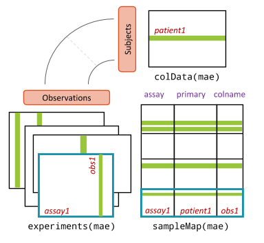

:::::::::::::::::::::::::::::::::::::: questions

- What data do we analyse in this lesson?
- How do we store several data types of the same samples in R?
- How do we find out which samples have which data types?
- How do we prepare each data type for integration?

::::::::::::::::::::::::::::::::::::::::::::::::

::::::::::::::::::::::::::::::::::::: objectives

- Describe the study design and the three data types of the HintikkaXO data.
- Describe the parts of a `MultiAssayExperiment`: the experiments, the sample information and the sample map, and how they differ from a `TreeSummarizedExperiment`.
- Access, explore and subset the experiments of a `MultiAssayExperiment`.
- Use an UpSet plot to see which samples have which data types, and keep only the samples that have all of them.
- Prepare each data type for integration, and explain why each data type gets its own transformation.

::::::::::::::::::::::::::::::::::::::::::::::::

## Where are we?

```{r workflow, echo=FALSE, out.width="40%", fig.alt="Microbiome data science workflow with the data integration step highlighted: taxonomic profiles and metabolic profiles are combined in a joint analysis."}
knitr::include_graphics("fig/workflow-integration.png")
```

In a microbiome analysis, the first step is to store the data in one
object, a `TreeSummarizedExperiment` (TreeSE). Integration starts
the same way: we store all data types in **one object**, and prepare each of
them for the analyses of the next episodes.

## The study

We use data from a diet experiment in rats
([Hintikka et al. 2021](https://doi.org/10.3390/ijerph18084049)). Forty rats
were fed one of four diets for several weeks:

|  | No supplement | XOS supplement |
|---|---|---|
| **Low-fat diet** | 10 rats | 10 rats |
| **High-fat diet** | 10 rats | 10 rats |

A high-fat diet causes obesity and fatty liver. Xylo-oligosaccharides (XOS)
are a **prebiotic**: a fibre that humans and rats cannot digest, but some gut
bacteria can. The study asked whether XOS changes the gut microbiota and
protects the rats from the harmful effects of the high-fat diet.

At the end of the experiment, three data types were measured for every rat:

- **microbiota**: the bacteria in the caecum (part of the gut), from 16S rRNA
  gene sequencing. The table contains read counts of taxa;
- **metabolites**: the concentrations of 38 known metabolites in the caecum,
  such as short-chain fatty acids, measured with nuclear magnetic resonance
  (NMR) spectroscopy;
- **biomarkers**: 39 lab measurements of host tissues, such as fat and
  microRNAs in the liver, and markers of inflammation in fat tissue. Each
  biomarker has its own unit.

The microbiota and the metabolites both come from the caecum content. The
biomarkers come from other tissues of the same rat, such as the liver, fat
tissue, muscle and blood. The three data types are truly different
measurements, unlike taxa and pathways computed from the same reads
([episode 1](01-introduction.Rmd)).

Note two things. The microbiota was measured with 16S amplicon
sequencing, so the counts are real read counts and the taxa are reliable
down to the genus. And the study is an experiment: the diet was set by the researchers, so all
three data types may change with it. Keep this in mind. When two data types
both change with the diet, they look related even if they do not affect
each other directly.

The data comes with the mia package as the `HintikkaXOData` dataset, so
there is nothing to download.

## Load packages and data

```{r load-packages, message=FALSE, warning=FALSE}
library(mia)
library(miaViz)
library(MultiAssayExperiment)
library(ggplot2)
```

The data comes with mia. We load it with `data()` and give it a shorter name:

```{r load-data}
data("HintikkaXOData", package = "mia")
mae <- HintikkaXOData
mae
```

## What is a MultiAssayExperiment?

A TreeSE holds **one** kind of feature (rows), such as taxa, measured from a
set of samples (columns). Our study has three kinds of features: taxa,
metabolites and biomarkers. To keep them together, Bioconductor has the
**`MultiAssayExperiment`** (MAE) class.

```{r mae-figure, echo=FALSE, out.width="55%", fig.alt="Diagram of a MultiAssayExperiment. On the left, several experiments are stacked; each is a table of features by observations. At the top, colData holds one row per subject (patient). On the right, sampleMap is a table with the columns assay, primary and colname, which links each observation in each experiment to a subject in colData."}

```

An MAE has three parts:

- **`experiments()`**: a list of experiments. Each experiment is one data type
  stored as its own object, here a TreeSE. The rows are the features and the
  columns are the samples, as before.
- **`colData()`**: one shared table of sample information, with one row per
  *subject*, here one row per rat.
- **`sampleMap()`**: a table that links each column of each experiment to a
  subject in `colData()`. Thanks to it, the MAE knows which columns belong to
  the same rat, even if they are named differently or in a different order.

Compared with a TreeSE:

| | TreeSE | MAE |
|---|---|---|
| Data | Tables of the same features, `assay()` | Experiments with different features, `experiments()` |
| Pick one table | `assay(tse, "counts")` | `mae[["microbiota"]]` (a TreeSE) |
| Sample information | `colData(tse)`, one row per column | `colData(mae)`, one row per subject |
| Subset | `tse[features, samples]` | `mae[features, subjects, experiments]` |

The printout above shows that our MAE has three experiments, all with 40
columns: `microbiota` with `r nrow(mae[["microbiota"]])` rows (taxa),
`metabolites` with `r nrow(mae[["metabolites"]])` rows and `biomarkers` with
`r nrow(mae[["biomarkers"]])` rows.

## Look inside the MultiAssayExperiment

`names()` gives the names of the experiments, and `[[` picks one of them. The
result is an ordinary TreeSE, and all the usual TreeSE functions work on
it:

```{r access-experiments}
names(mae)
mae[["metabolites"]]
assayNames(mae[["metabolites"]])
assay(mae[["metabolites"]], "nmr")[1:5, 1:5]
```

The shared sample information is in `colData()`, and `$` accesses one of its
columns, as with a TreeSE:

```{r access-coldata}
colData(mae)
table(mae$Fat, mae$XOS)
```

Each of the four diets has 10 rats. The column `XOS` is a number (0 or 1).
We turn it into a factor with clear labels, which will make the plots easier
to read:

```{r xos-factor}
mae$XOS <- factor(mae$XOS, levels = c(0, 1), labels = c("control", "XOS"))
table(mae$Diet, mae$XOS)
```

Finally, `sampleMap()` shows how the columns of the experiments are linked to
the rats:

```{r samplemap}
sampleMap(mae)
```

There is one row for each column of each experiment: 3 experiments × 40
samples = `r nrow(sampleMap(mae))` rows. The column `assay` is the experiment,
`primary` is the subject (the rat, a row of `colData(mae)`), and `colname` is
the name of the column in the experiment. For rat `C1`, there is one column
in each experiment:

```{r samplemap-rat}
sampleMap(mae)[sampleMap(mae)$primary == "C1", ]
```

In our data, `primary` and `colname` are the same, because each rat has one
sample per data type with the same name. They differ when the names
differ, for example `C1_16S` and `C1_NMR`, or when a rat has several samples
in one experiment, for example `C1_week0` and `C1_week8` before and after the
diet. Both columns then have the primary `C1`, and they share the sample
information of rat `C1`.

### Experiments with the sample information

The experiments inside the MAE have no sample information of their own:
it is stored once, in `colData(mae)`.

```{r experiment-coldata}
colData(mae[["microbiota"]])
```

When we need the sample information in an experiment, for example to colour
a plot by diet, `getWithColData()` returns the experiment with the matching
rows of `colData(mae)` added:

```{r get-with-coldata}
tse <- getWithColData(mae, "microbiota")
colData(tse)
```

`getWithColData()` warns that `'experiments' dropped`: it takes one
experiment out of the MAE and leaves the others behind. The warning is
harmless.

::::::::::::::::::::::::::::::::::::: challenge

## Challenge 1: Explore the biomarkers

1. Which tables (assays) does the `biomarkers` experiment contain?
2. List the names of the first ten biomarkers.
3. How many values are missing (`NA`) in the biomarkers? *Hint: `is.na()`
   and `sum()`.*
4. Which biomarker has the most missing values?

:::::::::::::::::::::::: solution

```{r challenge-biomarkers}
assayNames(mae[["biomarkers"]])
head(rownames(mae[["biomarkers"]]), 10)
sum(is.na(assay(mae[["biomarkers"]], "signals")))
na_per_biomarker <- rowSums(is.na(assay(mae[["biomarkers"]], "signals")))
head(sort(na_per_biomarker, decreasing = TRUE))
```

1. One assay, `signals`.
2. The names describe the measurement and the tissue, for example
   `Triglycerides_liver` (fat in the liver) or `CD45_Epi` (immune cells in
   the fat tissue around the testes, the *epididymal* fat).
3. `r sum(is.na(assay(mae[["biomarkers"]], "signals")))` values are missing.
4. `r names(which.max(na_per_biomarker))`, with
   `r max(na_per_biomarker)` missing values out of 40.

:::::::::::::::::::::::::::::::::
::::::::::::::::::::::::::::::::::::::::::::::::

## Which samples have which data types?

In our study, every rat has all three data types. In real studies, this is
often not the case: a sample fails in sequencing, or there was not enough
material to measure the metabolites. The MAE handles this without problems,
because the `sampleMap()` records which rats each experiment has.

To see how this looks, we make a copy of the data in which the biomarkers are
missing for the last 10 rats:

```{r mae-incomplete}
mae_incomplete <- mae
mae_incomplete[["biomarkers"]] <- mae_incomplete[["biomarkers"]][, 1:30]
mae_incomplete
```

An **UpSet plot** shows how many samples have each combination of data
types. The function `upsetSamples()` draws it:

```{r upset, warning=FALSE, fig.alt="UpSet plot of the samples. The bottom panel shows the combinations of experiments as connected dots, and the bars on top show how many samples have each combination: 30 samples have all three experiments, and 10 samples have only microbiota and metabolites."}
upsetSamples(mae_incomplete)
```

Each column of the bottom panel is a combination of experiments (the
connected dots), and the bar above it shows the number of samples with that
combination.

**Result:** 30 rats have all three data types, and 10 rats have only the
microbiota and the metabolites.

Many integration methods need the same samples in every experiment.
`intersectColumns()` keeps only the samples that are in all experiments:

```{r intersect-columns}
intersectColumns(mae_incomplete)
```

## Subset the MultiAssayExperiment

An MAE is subset with `[ , ]` like a TreeSE. The columns are the
samples, and the subset is applied to **all** experiments at once. Here we
keep only the rats on the high-fat diet:

```{r subset-samples}
mae_highfat <- mae[, mae$Fat == "High"]
mae_highfat
```

**Result:** each experiment now has `r ncol(mae_highfat[["microbiota"]])`
samples. The data types and the sample information stay in sync.

To keep only some experiments, we use the third index:

```{r subset-experiments, message=FALSE, warning=FALSE}
mae[, , c("microbiota", "metabolites")]
```

To keep only some features, `subsetByRow()` takes a list with the rows to keep
in each experiment. Here we keep three short-chain fatty acids and all
biomarkers:

```{r subset-rows}
subsetByRow(mae, list(metabolites = c("Butyrate", "Acetate", "Propionate"),
                      biomarkers = rownames(mae[["biomarkers"]])))
```

Experiments that are not in the list lose all their rows.

## Prepare the data

Each data type needs its own preparation before integration. The methods of
the next episodes expect values that are roughly normally distributed. Rare
features, which are zero in most samples, add noise rather than information.
The data types are measured in different ways
([episode 1](01-introduction.Rmd)), so each needs its own transformation:

| Experiment | Values | Preparation |
|---|---|---|
| `microbiota` | Read counts; compositional | Agglomerate, filter rare genera, rclr |
| `metabolites` | Concentrations; skewed, some below the detection limit | Replace `NA` with 0, log10 |
| `biomarkers` | Different units and scales, some `NA` | Keep as they are |

### Microbiota

The `microbiota` experiment has `r nrow(mae[["microbiota"]])` taxa, many of
them rare. We prepare it as in a single-table analysis: we agglomerate the taxa
to genera, keep the prevalent genera and transform the counts. First, we look
at the taxonomy:

```{r taxonomy}
tse <- mae[["microbiota"]]
head(rowData(tse), 3)
```

Each name has a prefix that tells its rank, such as `D_4__` for a family
and `D_5__` for a genus. The prefixes come from the SILVA taxonomy database,
and many datasets have them. They do not change the analysis, so we keep
them.

Now we agglomerate to genera, add relative abundances, keep the genera that
are found in at least 20 % of the rats with a relative abundance above 0.1 %,
and add an rclr table. The rclr transformation removes the effect of the
sequencing depth and makes the values closer to normally distributed:

```{r prepare-microbiota, message=FALSE}
tse <- agglomerateByRank(tse, rank = "Genus")
tse <- transformAssay(tse, assay.type = "counts", method = "relabundance")
tse <- subsetByPrevalent(tse, assay.type = "relabundance",
                         detection = 0.001, prevalence = 0.2)
tse <- transformAssay(tse, assay.type = "counts", method = "rclr")
tse
```

Some genera are called `uncultured`: they are known only from their DNA and
have no proper name. Their names are not unique, so mia adds a number, such
as `D_5__uncultured_2`.

We put the prepared TreeSE back into the MAE:

```{r put-back-microbiota}
mae[["microbiota"]] <- tse
```

**Result:** the microbiota now has `r nrow(mae[["microbiota"]])` prevalent
genera, with the assays `counts`, `relabundance` and `rclr`.

### Metabolites

The metabolite concentrations have some missing values:

```{r metabolites-na}
sum(is.na(assay(mae[["metabolites"]], "nmr")))
```

They are in only
`r sum(rowSums(is.na(assay(mae[["metabolites"]], "nmr"))) > 0)` of the
`r nrow(mae[["metabolites"]])` metabolites. We treat them as values below the detection limit of NMR: the metabolite was
there in too small amounts to be measured. So we replace them with 0. If the
values were missing because a measurement failed, this would be wrong.

The metabolites are absolute concentrations, not compositional counts, so we
do not use rclr. Concentrations are skewed (a few very high values), so we
add a log10 table. The logarithm of 0 is not defined, so
`pseudocount = TRUE` first adds half of the smallest concentration above 0
to all values:

```{r prepare-metabolites}
met <- mae[["metabolites"]]
assay(met, "nmr")[is.na(assay(met, "nmr"))] <- 0
met <- transformAssay(met, assay.type = "nmr", method = "log10",
                      pseudocount = TRUE)
mae[["metabolites"]] <- met
assayNames(mae[["metabolites"]])
```

### Biomarkers

The biomarkers are a mix of lab measurements, each with its own unit and
scale, and some have missing values (challenge 1). One transformation does
not fit all of them, so we keep them as they are. Where a method needs values
on the same scale, such as MOFA in [episode 4](04-unsupervised.Rmd), we
standardize each biomarker. MOFA also handles the missing values itself; for
other methods, we drop the biomarkers with missing values.

::::::::::::::::::::::::::::::::::::: challenge

## Challenge 2: Do the diets differ?

Before integrating the data types, it is good to look at each of them alone.

1. Draw box plots of the log10 concentrations of butyrate, acetate and
   propionate by `Diet`. *Hint: use `getWithColData()` to get the
   metabolites with the sample information. Then use `plotBoxplot()`
   with `features = ...`, `x = "Diet"` and `facet.by = "rownames"`.*
2. Make a PCA of the microbiota from its `rclr` table, and colour the rats by
   `Fat` and shape them by `XOS`. *Hint: `runPCA()` from scater and
   `plotReducedDim()`.*
3. Which factor, the fat or the XOS, has a larger effect on the
   metabolites and on the microbiota?

:::::::::::::::::::::::: solution

```{r challenge-boxplot, warning=FALSE, fig.alt="Box plots of the log10 concentrations of butyrate, acetate and propionate in the four diet groups."}
met <- getWithColData(mae, "metabolites")
plotBoxplot(met, assay.type = "log10", x = "Diet",
            features = c("Butyrate", "Acetate", "Propionate"),
            facet.by = "rownames") +
    theme(axis.text.x = element_text(angle = 45, hjust = 1))
```

```{r challenge-pca, message=FALSE, warning=FALSE, fig.alt="PCA plot of the rats based on the rclr-transformed genus abundances, coloured by fat in the diet and shaped by XOS. The high-fat and low-fat rats are separated along the first axis."}
library(scater)
tse <- getWithColData(mae, "microbiota")
tse <- runPCA(tse, assay.type = "rclr", name = "PCA", ncomponents = 3)
plotReducedDim(tse, "PCA", colour_by = "Fat", shape_by = "XOS")
```

The fat content of the diet has by far the larger effect. The high-fat rats
have less butyrate, acetate and propionate than the low-fat rats, and the
high-fat and low-fat rats are separated along the first axis of the PCA. The
effect of XOS is small in both data types. Keep this in mind: in the next
episodes, the strongest shared patterns will be about fat.

:::::::::::::::::::::::::::::::::
::::::::::::::::::::::::::::::::::::::::::::::::

## Keep the object

We use the prepared `mae` object in all the next episodes, so keep your R
session open. If you restart R, run the code of this episode again: the data
comes with mia, so this takes only a few seconds.

::::::::::::::::::::::::::::::::::::: callout

## Your own data

To build an MAE from your own data, first create one TreeSE (or
SummarizedExperiment) per data type, then combine them:

```{r own-data, eval=FALSE}
mae <- MultiAssayExperiment(
    experiments = ExperimentList(microbiota = tse_taxa,
                                 metabolites = tse_metabolites),
    colData = sample_info
)
```

If the columns of the experiments are named differently from the rows of
`sample_info`, also give a `sampleMap`. See the OMA chapter on
[data containers](https://microbiome.github.io/OMA/docs/devel/pages/containers.html)
and the
[MultiAssayExperiment vignette](https://bioconductor.org/packages/MultiAssayExperiment/).

:::::::::::::::::::::::::::::::::::::::::::::::

::::::::::::::::::::::::::::::::::::: keypoints

- The HintikkaXO data has three data types from 40 rats: microbiota, metabolites and host biomarkers. The rats were fed a high-fat or a low-fat diet, with or without the prebiotic XOS.
- A `MultiAssayExperiment` holds several experiments (here three TreeSEs), one shared table of sample information (`colData()`) and a `sampleMap()` that links them.
- `[[` picks one experiment, and `$` accesses the sample information. `getWithColData()` returns an experiment together with the sample information.
- `upsetSamples()` shows which samples have which data types, and `intersectColumns()` keeps the samples that have all of them.
- Subsetting by samples keeps all experiments in sync. `subsetByRow()` subsets the features of each experiment.
- `sampleMap()` links each column (`colname`) of each experiment to a subject (`primary`) in `colData()`.
- Each data type needs its own preparation: we agglomerate, filter and rclr-transform the compositional microbiota, replace values below the detection limit and log-transform the metabolites, and keep the biomarkers as they are.

::::::::::::::::::::::::::::::::::::::::::::::::
